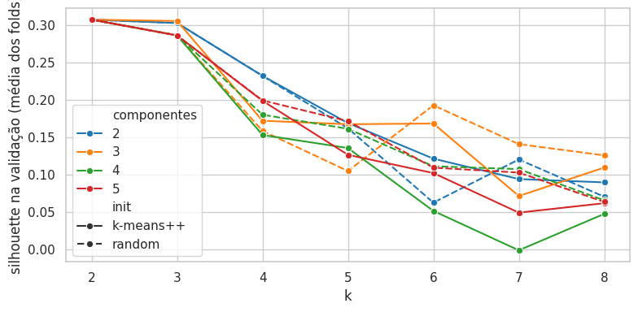
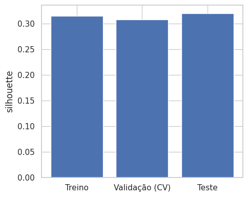
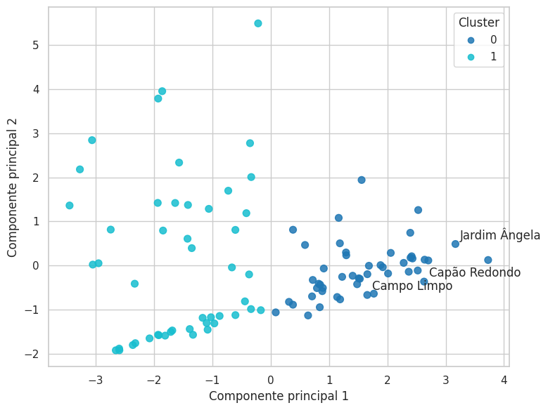

# Relatório de Machine Learning: Oportuniza

**Disciplina:** Inteligência Artificial & Machine Learning

**Integrantes:** Alexia Ramalho (558385), Enzo Real (557943), Gustavo Pasquini (555454), Hellen Silva (559008) e Lorenzo Acquesta (557397)

## 1. Problema

A Oportuniza quer orientar jovens da Zona Sul de São Paulo para cursos técnicos gratuitos. Antes de recomendar qualquer curso, precisamos entender o contexto de cada território. A pergunta que transformamos em Machine Learning foi: **que perfil de vulnerabilidade e de acesso à formação técnica pública têm os distritos de Capão Redondo, Campo Limpo e Jardim Ângela, comparados aos demais distritos da cidade?**

Como ninguém classificou os distritos antes, não há uma resposta certa para o modelo prever. É um problema **não supervisionado** de agrupamento (clusterização).

## 2. Dados

Usamos uma tabela com os **96 distritos** de São Paulo, que reúne três fontes públicas: indicadores sociais do ObservaSampa (referência 2022), o catálogo de ETECs do Centro Paula Souza (consultado em 2026, 44 unidades no município) e a divisão distrital do GeoSampa, usada para localizar cada ETEC no seu distrito. Os links e o dicionário de colunas estão em `dados/README.md`.

O modelo usa **7 variáveis**, todas proporcionais ao tamanho do distrito: percentual de 0 a 17 anos, famílias em extrema pobreza e de baixa renda (por 100 mil habitantes), domicílios em favelas (por 100 mil), taxa de universalização da educação básica, ETECs por 100 mil habitantes e registros de cursos por 100 mil.

Não havia valores ausentes nessas variáveis. Duas ressalvas importantes: os dados sociais (2022) e de ETEC (2026) são de períodos diferentes, e **58 dos 96 distritos não têm nenhuma ETEC**, então as variáveis de oferta têm muitos zeros.

## 3. Modelo e preparação

Escolhemos **KMeans** porque queremos formar grupos de distritos parecidos, sem variável-alvo. Antes dele aplicamos **PCA**, porque as variáveis sociais são muito correlacionadas entre si (pobreza extrema, baixa renda e favelas andam juntas), e essa informação repetida pesaria demais na distância do KMeans.

Dividimos os distritos em **75% para treino (72) e 25% para teste (24)**. O escalonamento (padronização), o PCA e o KMeans foram ajustados **somente com o treino**. O teste só recebeu essas transformações, o que evita vazamento de dados.

## 4. Treino e hiperparâmetros

Testamos **56 combinações** de três hiperparâmetros: número de componentes do PCA (2 a 5), número de grupos *k* (2 a 8) e inicialização do KMeans (`k-means++` ou `random`). Cada combinação foi avaliada com **validação cruzada de 5 folds dentro do treino**, medindo a silhouette no fold que ficou de fora. A silhouette vai de -1 a 1: quanto mais perto de 1, mais separados estão os grupos.

A melhor combinação foi **k = 2, 2 componentes e `k-means++`**, com silhouette de validação de 0,308. O k = 3 ficou praticamente empatado (0,306), então k = 2 foi escolhido por ser a solução mais simples, não por ser claramente superior.

## 5. Resultados

| Conjunto | Silhouette |
|---|---|
| Treino | 0,316 |
| Validação cruzada | 0,308 |
| Teste | 0,320 |

Os valores são praticamente iguais nos três conjuntos, então **não há sinal de overfitting**: o modelo não decorou o treino. O teste tem só 24 distritos, o que torna essa evidência modesta. Em 30 amostras com reposição, o ARI médio foi de **0,947** (mínimo 0,763), o que mostra que os grupos são estáveis. Por outro lado, uma silhouette perto de 0,3 indica que os dois grupos se sobrepõem em parte: há distritos na fronteira.

Ajustando o modelo com os 96 distritos, o resultado foram dois grupos de 48:

| Indicador (média do grupo) | Grupo 0 | Grupo 1 |
|---|---|---|
| População de 0 a 17 anos (%) | 25,6 | 18,5 |
| Famílias em extrema pobreza (por 100 mil hab.) | 6.825 | 3.173 |
| Famílias de baixa renda (por 100 mil hab.) | 3.724 | 1.551 |
| Domicílios em favelas (por 100 mil hab.) | 4.183 | 778 |
| Universalização da educação básica (%) | 97,0 | 113,9 |
| ETECs (por 100 mil hab.) | 0,17 | 0,79 |
| Registros de cursos (por 100 mil hab.) | 1,8 | 14,3 |

Capão Redondo, Campo Limpo e Jardim Ângela ficaram no **grupo 0**, o de maior vulnerabilidade. Os dois primeiros não têm ETEC no catálogo, e Jardim Ângela tem uma, com 7 registros de cursos.

## 6. Conclusão e leitura para o cidadão

Os distritos mais vulneráveis de São Paulo tendem a ter menos ETECs por habitante: o grupo 0 tem cerca de um quarto da oferta do grupo 1 (0,17 contra 0,79 por 100 mil habitantes). Para um jovem do Capão Redondo, isso significa morar num tipo de distrito com muita demanda por oportunidades e pouca oferta de ETEC dentro do próprio território.

Isso **não quer dizer que ele não tenha acesso a cursos**: ele pode estudar em ETECs de outros distritos, e o modelo não conhece transporte, vagas, critérios de seleção nem outras opções gratuitas (SENAI, CEUs, ONGs). Para orientar parcerias da Oportuniza, este diagnóstico deve ser combinado com uma lista validada de cursos e vagas.

**Limites.** Os dados misturam 2022 e 2026, os indicadores são aproximações, as variáveis de ETEC têm muitos zeros, a separação entre os grupos é moderada e o teste é pequeno. O KMeans mostra semelhanças entre distritos, mas não prova que renda ou oferta de ensino causem algum resultado.
